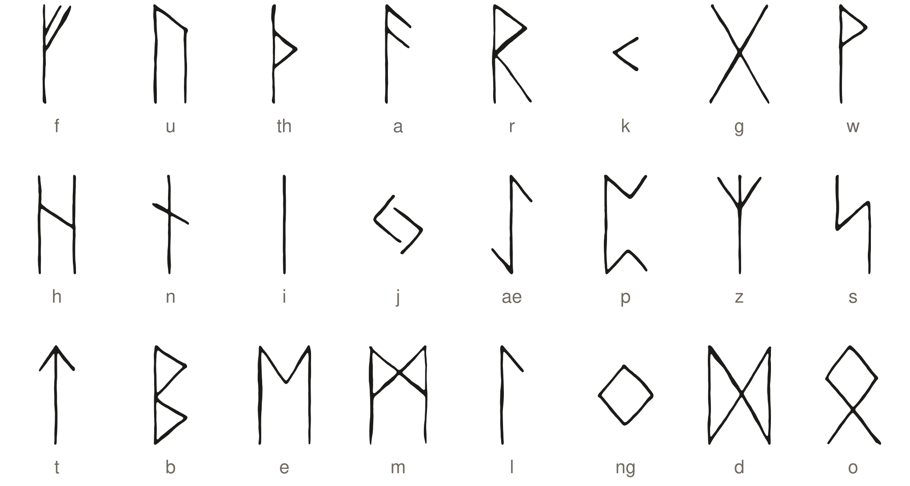

# Elder Futhark

A hand-drawn rune font. Type in English and it's written in Elder Futhark, the
oldest runic alphabet.

<picture>
  <source media="(prefers-color-scheme: dark)" srcset="images/preview-dark.svg">
  
</picture>

**[Try it live](https://michaelthomasletts.github.io/elder_futhark/)** · [Download](https://github.com/michaelthomasletts/elder_futhark/archive/refs/heads/main.zip) · [License: SIL OFL 1.1](LICENSE)

Every rune was drawn by hand with a pen, scanned at 1200 dpi and turned into
vector outlines. The cleanup keeps the hand-drawn wobble: stems were
straightened and a few slips corrected.

- 24 Elder Futhark runes plus three runic word separators (᛫ ᛬ ᛭)
- Type with an ordinary keyboard: `hello` becomes ᚺᛖᛚᛟ
- Automatic ligatures: **th** → ᚦ, **ng** → ᛜ, **ae** → ᛇ
- Optional phonetic spelling (**ph** → ᚠ, **x** → ᚲᛊ, **oo** → ᚢ, and more)
- Real Unicode runic text (ᚠᚢᚦᚨᚱᚲ) works too
- Regular and Bold weights, about 9 KB each as WOFF2

## Use it on a website

Add this to your CSS. The font files are served directly from this repository
by [jsDelivr](https://www.jsdelivr.com/), a free CDN, so there's nothing to
download:

```css
@font-face {
  font-family: "Elder Futhark";
  src: url("https://cdn.jsdelivr.net/gh/michaelthomasletts/elder_futhark@main/fonts/ElderFuthark-Regular.woff2") format("woff2");
  font-weight: 400;
  font-display: swap;
}
@font-face {
  font-family: "Elder Futhark";
  src: url("https://cdn.jsdelivr.net/gh/michaelthomasletts/elder_futhark@main/fonts/ElderFuthark-Bold.woff2") format("woff2");
  font-weight: 700;
  font-display: swap;
}

.runes {
  /* the fallback font supplies digits and punctuation the runes don't cover */
  font-family: "Elder Futhark", Georgia, serif;
}
```

Then write in English:

```html
<p class="runes">the north wind: sings through the high hall.</p>
```

> [!TIP]
> `@main` always serves the latest version. To lock your site to one version,
> replace `@main` with a release tag, such as `@v1.0.0`.

**Self-hosting:** copy the `.woff2` files from [`fonts/`](fonts/) into your
site and change the `url(...)` paths to point at them.

**Which weight?** Regular keeps the fine pen line of the original drawings and
looks best at about 24px and larger. Bold is easier to read at body-text sizes.
Use `font-weight: 700` (or `<b>`) to switch.

## Typing

Type Latin letters, upper or lower case:

| You type | You get |
|---|---|
| a b d e f g h i l m n o p r s t u z | one rune each |
| c, k, q, x | ᚲ (kaunan) |
| v, w | ᚹ (wunjo) |
| j, y | ᛃ (jera) |
| **th** | ᚦ (thurisaz) |
| **ae** | ᛇ (eihwaz) |
| **ng** | ᛜ (ingwaz) |
| `.` or `·` | ᛫ word separator (dot) |
| `:` | ᛬ word separator (double dot) |
| `+` | ᛭ word separator (cross) |

**Doubled letters are written once**, as in runic inscriptions: *hall* → ᚺᚨᛚ,
*back* → ᛒᚨᚲ.

Digits and other punctuation (`,` `?` `!`) aren't part of the alphabet; they
come from the next font in your `font-family` list. Text you copy stays in
English, so it remains searchable and accessible.

### Turning ligatures off

The **th / ae / ng** combinations and the doubled-letter rule are ligatures. To
get one rune per typed letter instead:

```css
.runes { font-variant-ligatures: none; }
```

### Phonetic spelling (optional)

An optional set of rules spells words by sound rather than by English spelling.
It's off by default:

| You type | Default | Phonetic |
|---|---|---|
| ph (*phone*) | ᛈᚺ | ᚠ |
| qu (*queen*) | ᚲᚢ | ᚲᚹ |
| x (*fox*) | ᚲ | ᚲᛊ |
| ei (*their*) | ᛖᛁ | ᛇ |
| oo (*moon*) | ᛟ | ᚢ |
| ue, ew (*blue*, *new*) | ᚢᛖ, ᛖᚹ | ᚢ |
| ee (*see*) | ᛖ | ᛁ |
| oa (*boat*) | ᛟᚨ | ᛟ |
| c before e, i, y (*city*, *ice*) | ᚲ | ᛊ |
| sh (*ship*) | ᛊᚺ | ᛊ |
| wh (*what*) | ᚹᚺ | ᚹ |
| wr (*write*) | ᚹᚱ | ᚱ |
| kn (*knight*) | ᚲᚾ | ᚾ |
| dg (*edge*) | ᛞᚷ | ᛃ |

These follow common English spelling, so some words come out wrong:
*book* and *door* get ᚢ, *koala* loses its ᚨ, and *guess* gets ᚢ.

To turn it on:

```css
.runes-phonetic { font-feature-settings: "ss01"; }
```

## Desktop use

Download [`ElderFuthark-Regular.otf`](fonts/ElderFuthark-Regular.otf) and
[`ElderFuthark-Bold.otf`](fonts/ElderFuthark-Bold.otf), then double-click each
to install. Ligatures work automatically in most design apps, such as Figma,
Pages and the Adobe apps. In Microsoft Word, turn them on under
**Format → Font → Advanced → Ligatures → Standard Only**.

## What's in this repository

| Path | Contents |
|---|---|
| [`fonts/`](fonts/) | The font: `.woff2` for the web, `.otf` for desktop |
| [`svg/`](svg/) | Each rune as a standalone SVG, for icons, print or laser cutting |
| [`index.html`](index.html) | The live demo page, served by GitHub Pages |
| [`images/`](images/) | The preview image in this README |

## License

Elder Futhark is free to use under the [SIL Open Font License 1.1](LICENSE):

- **You can** use it on websites, in apps, documents, logos and commercial
  projects.
- **You can** modify it and share your changes.
- **You can't** sell the font itself.

Drawn by Michael Letts.
